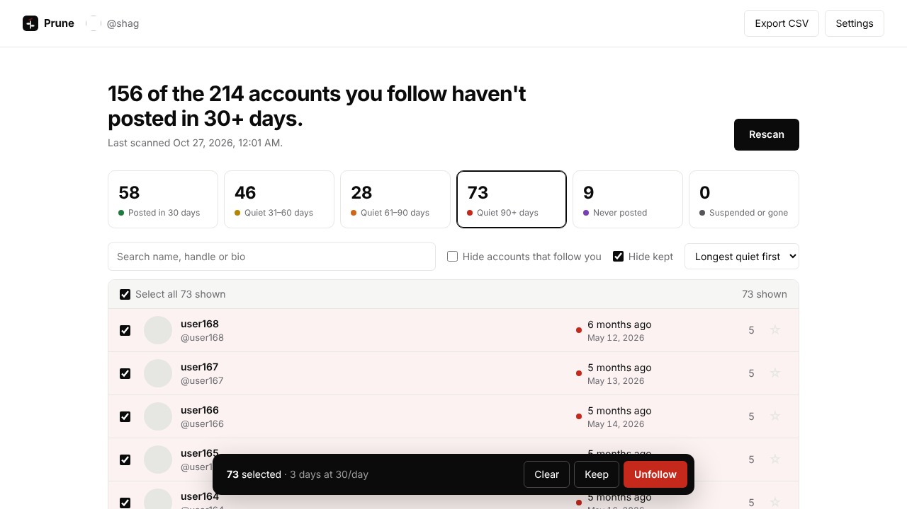

# Prune for X

Find the dead accounts you follow on X, sorted by when they last posted, and unfollow them at a safe pace.

Prune is a browser extension that runs entirely on your machine. It talks to x.com through the session you're already signed in with, the same way the X website does. No server, no API keys, no OAuth app, no analytics. Your following list never leaves your browser.



## What it does

- Loads everyone you follow and the date of each account's latest post
- Groups them: posted in the last 30 days, quiet 31–60, quiet 61–90, quiet 90+, never posted, suspended or gone
- Lets you filter, search, hide mutuals, and star accounts to keep forever
- Unfollows the selection slowly: random 6–14 second gaps, quietest accounts first, and a rolling 24-hour cap (350 by default)
- Stops immediately if X reports a lock or limit
- Exports to CSV

A scan of 1,000 to 2,000 follows usually takes under a minute, because X's web API returns each account's latest post alongside the following list.

## Install

Works in any Chromium browser: Chrome, Dia, Arc, Brave, Edge.

1. Download this repo (Code → Download ZIP) and unzip it, or `git clone` it
2. Open `chrome://extensions` (Dia/Arc/Brave/Edge all accept this URL)
3. Turn on **Developer mode**
4. Click **Load unpacked** and pick the folder that contains `manifest.json`
5. Sign in to x.com in the same browser
6. Click the Prune icon in the toolbar, then **Scan my following**

## How it works

| Step | Primary method | Fallback |
|---|---|---|
| Following list | `1.1/friends/list` (200 per call, includes latest post) | GraphQL `Following` |
| Latest post | Included above | `1.1/users/lookup`, then GraphQL `UserTweets`, then reading the profile page |
| Unfollow | `1.1/friendships/destroy` | Clicking **Following → Unfollow** on the profile page |

X changes its internal GraphQL query IDs whenever it ships a new web bundle. Prune doesn't hardcode them: it watches the requests X's own site makes and, if needed, reads the IDs and feature flags straight out of X's JavaScript bundle. Missing feature flags are learned from X's error responses and retried.

Rate limits are read from X's response headers. When a limit is close, Prune waits for the reset and shows a countdown.

### Files

```
manifest.json
src/hook.js          MAIN-world script on x.com: learns query IDs, runs requests with your session
src/bridge.js        content script: relays dashboard ⇄ page, DOM fallbacks
src/background.js    opens the dashboard
src/dashboard.*      the UI
src/lib/x.js         request client, rate-limit handling, strategies
src/lib/scan.js      scan orchestration and fallbacks
src/lib/unfollow.js  throttled unfollow queue with daily cap
src/lib/parse.js     pure parsers for X's JSON (unit tested)
src/lib/store.js     chrome.storage wrapper
```

## Safety notes

- X doesn't publish an unfollow limit. Bulk unfollowing hundreds per hour is what gets accounts temporarily locked. The defaults (350 per 24h, 6–14s apart) are deliberately conservative. You can change them in Settings.
- Keep the dashboard tab open while a queue runs. You can pause or stop at any time; progress is saved.
- "Last post" includes reposts by default. Turn that off in Settings if you only care about original posts.
- Protected accounts you've been approved to follow are checked normally.

## Privacy

Permissions: `storage` (save results locally), `tabs` (find or open an x.com tab), and host access to `x.com`, `twitter.com` and `abs.twimg.com` (X's JS bundle, to read query IDs). That's it. There is no network code that talks to anything else; read `src/` to confirm.

Settings → **Erase all Prune data** wipes everything Prune stored.

## Development

```sh
npm test            # unit tests for the parsers (node:test, no deps)
npm run check       # syntax check
node test/e2e.mjs   # loads the real extension in Chromium against a mocked x.com (needs Playwright)
FAST=1 node test/e2e.mjs   # same, exercising the friends/list fast path
npm run zip         # build prune.zip
```

The e2e test runs a full scan and unfollow queue against 250 fake accounts, covering the fast path, the GraphQL fallback, feature-flag retry, per-account fallback, suspended and never-posted detection, the daily cap, and quietest-first ordering.

If X changes something and Prune breaks, the Activity log at the bottom of the dashboard shows which request failed. Issues and PRs welcome.

## Not affiliated with X

Prune uses X's private web endpoints, which can change without notice. Use it on your own account at your own risk.

## License

MIT
